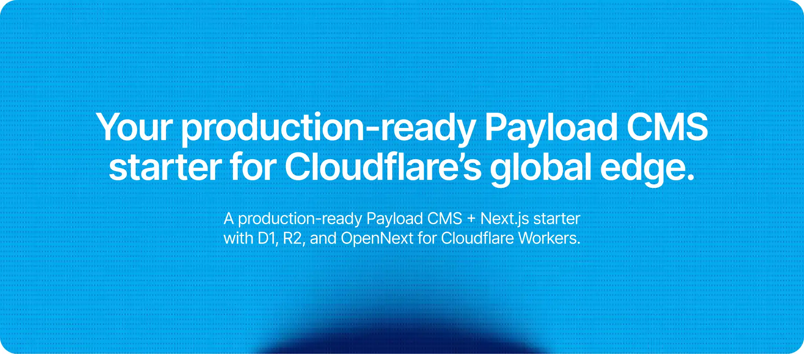

Payloadflare is a starter for building content-managed websites with [Payload CMS](https://payloadcms.com/) and [Next.js](https://nextjs.org/), designed to be hosted on [Cloudflare Workers](https://developers.cloudflare.com/workers/).

It is derived from [Payload's official Cloudflare D1 template](https://github.com/payloadcms/payload/tree/main/templates/with-cloudflare-d1).

> **Important:** This starter currently exceeds the Cloudflare Workers Free plan's script-size limit, so deployment requires a paid Workers plan.

It includes authenticated admin users, public media uploads, a form builder, and a frontend driven by the Pages collection. Data is stored in [D1](https://developers.cloudflare.com/d1/) and media in [R2](https://developers.cloudflare.com/r2/).

## Run locally

Requirements: Node.js 24.22.1 or later, pnpm, and a Cloudflare account.

```bash
pnpm install
pnpm wrangler login
```

Create a `.env` file with:

```dotenv
# Generate a secret with `openssl rand -hex 32`.
PAYLOAD_SECRET=replace-with-a-random-secret
NEXT_PUBLIC_SERVER_URL=http://localhost:3000
```

Initialize a new local database, then start the app:

```bash
pnpm payload migrate
pnpm dev
```

- Website: `http://localhost:3000`
- Payload admin: `http://localhost:3000/admin`

## Keep your project up to date

To bring template improvements into a project created from this repository, add this repository as an `upstream` remote once:

```bash
git remote add upstream https://github.com/larussverris/payloadflare.git
```

Then fetch and merge template updates when needed:

```bash
git fetch upstream
git merge upstream/main
```

Resolve any merge conflicts, then run the relevant checks before deploying.

## Deploy to Cloudflare

Replace the placeholder names and IDs in `wrangler.jsonc` with your Worker, D1, and R2 resources.

### Workers Builds

Under **Workers & Pages → your Worker → Settings → Builds**, use:

| Setting           | Value                                    |
| ----------------- | ---------------------------------------- |
| Build command     | `pnpm exec opennextjs-cloudflare build`  |
| Deploy command    | `pnpm exec opennextjs-cloudflare deploy` |
| Version command   | `pnpm exec opennextjs-cloudflare upload` |
| Root directory    | `/`                                      |
| Production branch | `main`                                   |

Set required build-time values under **Build variables and secrets**.

The app uses:

- `D1` for Payload data
- `R2` for Payload media uploads
- `NEXT_INC_CACHE_R2_BUCKET` for the Next.js incremental cache
- `NEXT_TAG_CACHE_D1` for cache-tag invalidation
- `NEXT_CACHE_DO_QUEUE` to coordinate ISR revalidation
- `WORKER_SELF_REFERENCE` as the Worker's self-service binding
- `EMAIL` to send transactional email through Cloudflare Email

### Configure transactional email

Set `EMAIL_FROM_ADDRESS` and `EMAIL_FROM_NAME` in `.env.local` for development and in
the Worker's environment for production. Both are required; there are no fallback values.
Keep `EMAIL_FROM_ADDRESS` in sync with `allowed_sender_addresses` on the `EMAIL` binding in
`wrangler.jsonc`. The sender address must use a domain onboarded to Cloudflare Email. Onboard the
domain before sending mail:

```bash
pnpm wrangler email sending enable example.com
```

The `@payloadflare/email-cloudflare` workspace package is configured in `src/payload.config.ts`, so auth emails and `payload.sendEmail(...)` use the `EMAIL` binding.

### Enable D1 read replication

The `first-primary` strategy is enabled in `src/payload.config.ts`, but replicas must also be enabled on the database itself:

1. Open the D1 database in the Cloudflare dashboard.
2. Go to **Settings**.
3. Enable **Read Replication**.

### Media storage

Payload stores uploads in the `R2` bucket and serves files through `/api/media/file/<filename>` in both development and production. No separate media domain or media URL environment variable is required.

Public image responses use a 30-day browser TTL and a 30-day edge TTL in production. Development image responses use `no-store`. [Workers Cache](https://developers.cloudflare.com/workers/cache/) is enabled in `wrangler.jsonc`, using the standard OpenNext entrypoint. Payload's `Media` collection sets the file response cache headers; `next.config.ts` excludes application routes outside `/api/media/file/` from Workers Cache. Non-image file responses handled by the media header hook also opt out. OpenNext's existing internal caches and browser cache headers are preserved. No custom Worker wrapper or dashboard Cache Rule is needed.

On a cache miss, Payload retrieves the image from R2. On a hit, Cloudflare serves the cached image at the same `/api/media/file/` URL without executing Payload. This shared caching assumes the collection's current public read access (`read: () => true`); private media needs a different cache policy. File-route errors that do not reach the media header hook follow their response headers and Cloudflare's default cache behavior.

After deploying, request the same uploaded image twice using `curl -sS -D - -o /dev/null https://yourdomain.com/api/media/file/example.jpg` and check for `CF-Cache-Status: HIT` on a repeated request. Also verify `/admin` and `/api/media` do not produce cache hits. Edge behavior must be verified on Cloudflare, not just with `pnpm dev`.

Media keeps Payload's normal upload filenames. The `mediaURLVersions` plugin from the `@payloadflare/media-url-versions` workspace package in `packages/media-url-versions/` is configured for Media in Payload config. It attaches an `afterRead` hook that appends `?v=<updatedAt timestamp>` to the main file URL only. It leaves `thumbnailURL` and image-size URLs unchanged. Replacing a file or editing metadata changes the URL version, allowing browsers and Cloudflare to fetch fresh content. Consumers should use the returned `url` rather than reconstructing a URL from `filename`, and selected media reads must include `updatedAt` to receive versioning. Cache keys must include the `v` query parameter. Existing randomly named R2 objects are not renamed; their URLs also receive versions. The legacy `displayFilename` field has been removed; existing installations should generate their own cleanup migration. The filename-randomization plugin is no longer enabled.

Verify a same-name file replacement in the admin and on the deployed site: the returned URL's `v` value should change and the new URL should serve the replacement bytes. Old URLs can continue serving cached content until expiry; query versions are cache keys, not archived file versions. Purging cannot remove copies already cached in browsers.

### Deploy schema and application changes

This template ships without migration history. Generate an initial migration before your first deployment, then generate migrations for subsequent schema changes. Commit the generated migration files and index to your project repository:


```bash
pnpm payload migrate:create
```

Deploy the database migration and application together:

```bash
pnpm deploy
```

## Pages and live preview

Create a page and use its page settings to make it the homepage at `/`.
The homepage has no parent; selecting another page as homepage replaces the current
one. The template does not seed a homepage through migrations.

Create other pages with a single slug segment, such as `team`, and optionally
choose a parent to produce a URL such as `/about/team`. One optional catch-all
route renders Home and regular pages. Avoid existing routes such as `admin`, `api`, and `preview`. Missing and unpublished pages return 404 to public visitors.

The editable 404 global is shown as a Payload UI card below the Pages list and pagination. Unexpected errors
use Next.js’s built-in error page.

Add Image and Video blocks to a page's layout. Image selects an image from Media
and supports an optional caption.
Video selects an uploaded video and supports a caption and WebVTT
closed captions with a language code. Videos render with playback controls and
do not autoplay. All uploads use the `MAX_UPLOAD_SIZE` limit.
Each block lives
in `src/blocks/<BlockName>/`, with its schema in `config.ts` and its frontend renderer
in `index.tsx`. Use named component exports and import implementations from the
block directory. Register additional renderers in `src/components/BlocksRenderer.tsx`.

Preview uses dedicated, authenticated URLs under `/preview`. The admin's Preview
button opens a standalone draft preview; Live Preview uses the same routes inside
its iframe and refreshes after autosaves. Pages preview at `/preview/<page-path>`,
and the homepage at `/preview`. Any unmatched preview path renders the 404 global's
draft; its admin preview link uses `/preview/not-found-preview` as a missing path.

Every preview read verifies the Payload session and reads drafts without the public
cache. Preview responses are dynamic and marked `noindex`. Public URLs always read
published content, even for signed-in editors or browsers with an old Draft Mode
cookie. Preview does not set a Draft Mode cookie and needs no exit-preview action.

Reserve the `/preview` prefix for this feature. Preview links follow saved slugs
and hierarchy; new documents must be saved before previewing. Set
`NEXT_PUBLIC_SERVER_URL` to the origin used for the app.

## Site revalidation

`src/payload.config.ts` attaches shared Payload hooks when registering collections
and globals, preserving their existing hooks. The hooks revalidate the site after
published changes, unpublishing, changes to content without drafts, and collection
document deletions. Autosaves and draft-only saves are skipped.

## Page SEO

Published pages are included in the sitemap. Not-found responses remain `noindex`.

Pages renders layout blocks in the main editor and SEO fields in its settings drawer.
Payload's SEO plugin stores each page's title, description, and sharing image in `meta`;
images come from the existing Media collection. The plugin shares the Payload
version pinned in the workspace catalog.

The frontend renders Next.js metadata, canonical URLs, Open Graph, and Twitter
sharing tags from these fields, falling back to Site Settings for the description
and sharing image. The default homepage title is the site name; other pages fall
back to their page title. Preview responses include a noindex directive.

## Optimizations

- **CMS metadata** serves the sitemap from published pages and `llms.txt` from Site Settings.
- **Published content caching** reuses published pages, site settings, 404 content, and the sitemap for an hour. CMS changes invalidate the shared `site` tag immediately, including unpublishing; draft page previews bypass the cache.
- **Persistent Next.js cache** stores SSG, ISR, and data-cache entries in R2.
- **Regional cache** keeps frequently read cache entries close to the Worker for up to one minute.
- **D1 read replicas** use Payload's `first-primary` strategy for consistent reads with lower latency after the initial primary query.
- **On-demand invalidation** is supported through D1-backed Next.js cache tags when application code revalidates tagged content.
- **Deduplicated revalidation** uses a Durable Object queue to avoid repeated ISR work.
- **Cloudflare image transformations** resize images at `/cdn-cgi/image`, negotiate the output format automatically, and default to quality 85.
- **Static asset caching** keeps Next.js's hashed `/_next/static/*` files immutable for one year and manually managed `/static/*` files cached for 30 days.
- **React Compiler** is enabled for automatic React rendering optimizations.
- **Worker-aware bundling** keeps `jose` and `pg-cloudflare` external for the workerd runtime.
- **Production logging** writes structured JSON through `console`, which integrates with Cloudflare Workers logs.

## Static files

Put manually managed assets in `public/static/` (create the directory when needed):

```text
public/static/logo.svg  ->  /static/logo.svg
```

Everything under `/static/*` is served with:

```http
Cache-Control: public,max-age=2592000
```

These files are cached by browsers for 30 days. Versioned filenames such as `logo-v2.svg` or `logo.abcd1234.svg` are still useful when an update must appear immediately.

Other files placed directly in `public/` use Cloudflare's normal static-asset caching unless another rule is added to `public/_headers`.

Set the required `MAX_UPLOAD_SIZE` environment variable in bytes (for example,
`6291456` for 6 MiB). There is no fallback value. Payload's Sharp-based crop and focal-point tools are disabled because Sharp is not supported in the Workers runtime.

Pages nest under other pages using Payload's native hierarchy and parent selector.
Each parent is a real page: `about` serves `/about`, and its child `team` serves
`/about/team`. Payload computes `_h_slugPath` on read; moving or renaming a parent
updates descendant URLs without rewriting those pages. The page marked as the
homepage serves `/`.

The separate folder model is no longer used. Existing folder records and page-folder
assignments are not converted; no data migration is included.
